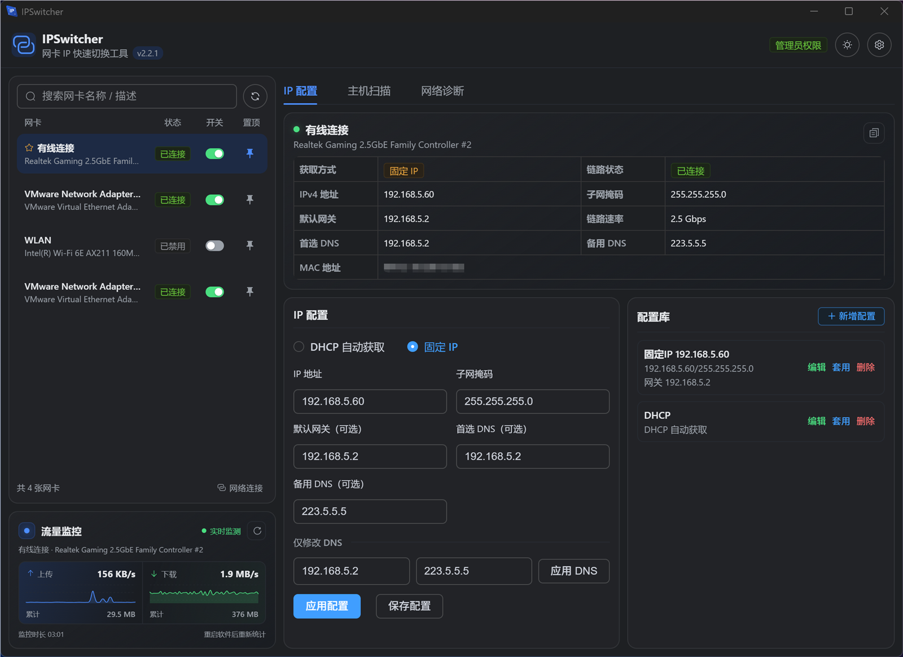
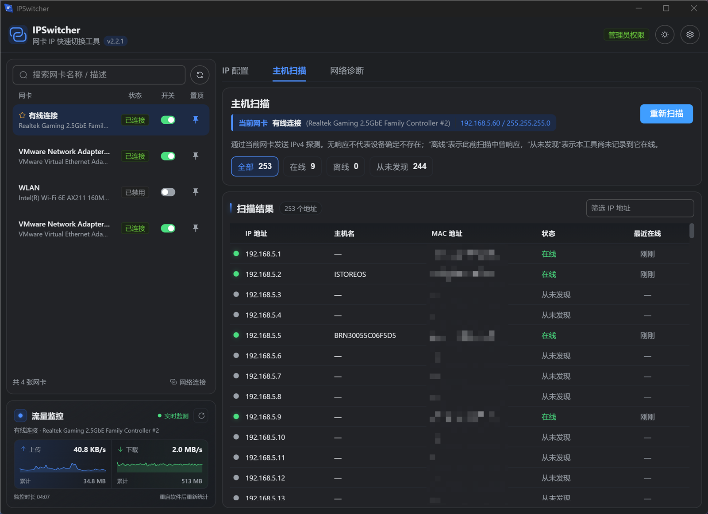
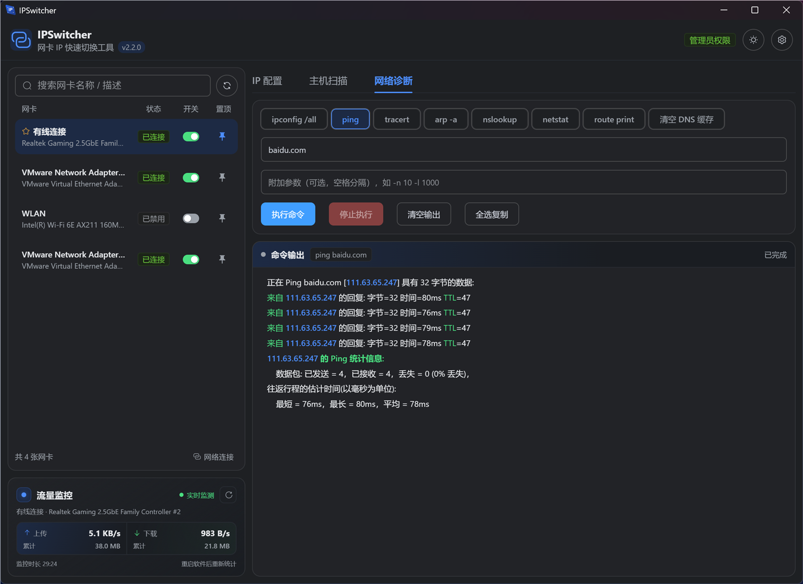
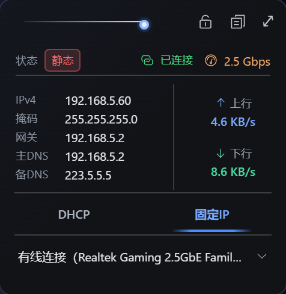

# IPSwitcher 网卡 IP 快速切换工具

基于 **Tauri v2 + Vue 3 + TypeScript + Vite + Element Plus** 的 Windows 桌面工具，支持网卡 IP/DNS 快速切换、多网卡批量管理、配置库保存与新建、主机扫描、实时流量监控（含速率趋势曲线）、常用网络诊断，并支持应用内检查版本更新。

## 界面预览

**主窗口 · IP 配置**



**主机扫描**



**网络诊断**



**桌面挂件**

| 挂件 · 半透明 | 挂件 · 实色 |
| --- | --- |
|  |  |

## 技术栈

- 桌面框架：Tauri v2（Rust 后端，Windows 原生接口 / netsh / CIM-WMI）
- 前端：Vue 3 + TypeScript + Vite + Element Plus
- 适配系统：Windows 10 / Windows 11 x64

## 快速开始

### 环境要求

- Node.js 20.19+ / 22 LTS
- Rust 1.77+（MSVC 工具链，Visual Studio 生成工具）
- WebView2 运行时

### 命令

```bash
# 安装前端依赖
npm install

# 开发模式（启动 Vite 与 Tauri 窗口）
npm run app:dev

# 仅构建前端静态产物
npm run build

# 发布构建（编译 release 并生成 NSIS 安装包）
npm run app:build
```

## 核心后端命令

| 命令 | 说明 |
| --- | --- |
| `list_adapters` | 枚举网卡及当前配置（CIM/WMI + Get-NetAdapter） |
| `get_adapter_traffic` | 读取网卡累计收发字节（Windows IP Helper API） |
| `apply_static` | 应用静态 IP（可同步 DNS） |
| `apply_dhcp` | 切换 DHCP，可选同时恢复 DNS 自动获取 |
| `apply_dns` | 仅修改 DNS 服务器 |
| `set_adapter_enabled` | 启用 / 禁用指定网卡 |
| `rename_adapter` | 重命名网卡 |
| `open_network_connections` | 打开系统「网络连接」面板（ncpa.cpl） |
| `run_diagnostic` / `stop_diagnostic` | 异步执行诊断命令并支持停止，逐行回流 `diag-line` 事件 |
| `run_host_scan` / `stop_host_scan` | 异步探测主机并支持停止 |
| `elevate_action` | 落盘待决操作并以管理员身份重启执行（UAC） |
| `get_config` / `save_config_cmd` | 读取 / 保存本地配置 |
| `check_admin` | 判断当前是否具备管理员权限 |
| `set_autostart` / `get_autostart` | 读写开机自启状态 |
| `create_desktop_shortcut` | 创建桌面快捷方式 |
| `check_update` | 检查 GitHub Release 是否存在新版本，并按当前分发形态匹配更新资产；直连失败自动回退内置加速节点 |
| `download_update` | 下载更新包到临时目录，流式回传下载进度；直连失败依次回退加速节点，优先校验 SHA256、缺失时回退校验大小 |
| `apply_update` | 应用更新：安装版拉起安装器，绿色 / 便携版退出后覆盖主程序并重启 |

> 挂件显隐、透明度、尺寸固定、主题切换等内部命令由前端挂件组件直接调用，未在上表列出。

## 配置持久化

- 便携版：可执行文件同级目录 `config.json`（存在 `portable.marker` 标记时启用）
- 安装版：`%APPDATA%\com.jamhoo.ipswitcher\config.json`

## 下载产物

最新版本见 [Releases](https://github.com/colour008/ipswitcher/releases)，当前 v2.2.9 产物如下：

| 产物 | 文件 | 说明 |
| --- | --- | --- |
| NSIS 安装包 | [IPSwitcher_2.2.9_x64-setup.exe](https://github.com/colour008/ipswitcher/releases/download/v2.2.9/IPSwitcher_2.2.9_x64-setup.exe) | x64 安装包，可选安装路径、创建桌面快捷方式 |
| 绿色便携版 | [IPSwitcher_v2.2.9_portable.zip](https://github.com/colour008/ipswitcher/releases/download/v2.2.9/IPSwitcher_v2.2.9_portable.zip) | 解压即用，配置保存在程序同级目录 |
| 免安装单文件 | [IPSwitcher.exe](https://github.com/colour008/ipswitcher/releases/download/v2.2.9/IPSwitcher.exe) | 单文件可执行程序 |

## 路线图

**基础体验**

- IPv4 / IPv6 分离显示
- 配置备份与导入导出（JSON）
- 常用 DNS 快捷切换

**核心能力**

- 单网卡多 IP + 多 DNS
- 挂件内直接切换配置

**运维工具**

- DHCP 服务器枚举
- 网络连通性自检（网关 / 外网 / DNS）
- IP 占用 / 冲突检测
- 网卡维护操作（重置适配器、刷新 ARP、清空 DNS 缓存）
- 托盘菜单快捷切换
- 扫描结果导出（复制 / CSV）
- 配置快照与一键还原

详细使用说明见 [使用说明.md](./使用说明.md)。
